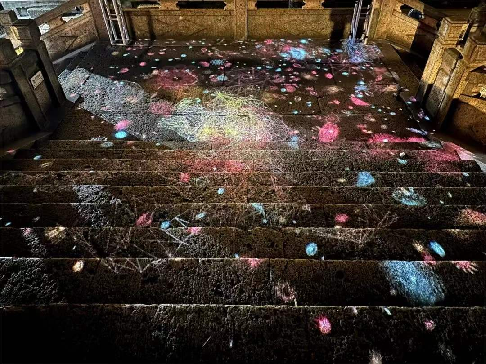
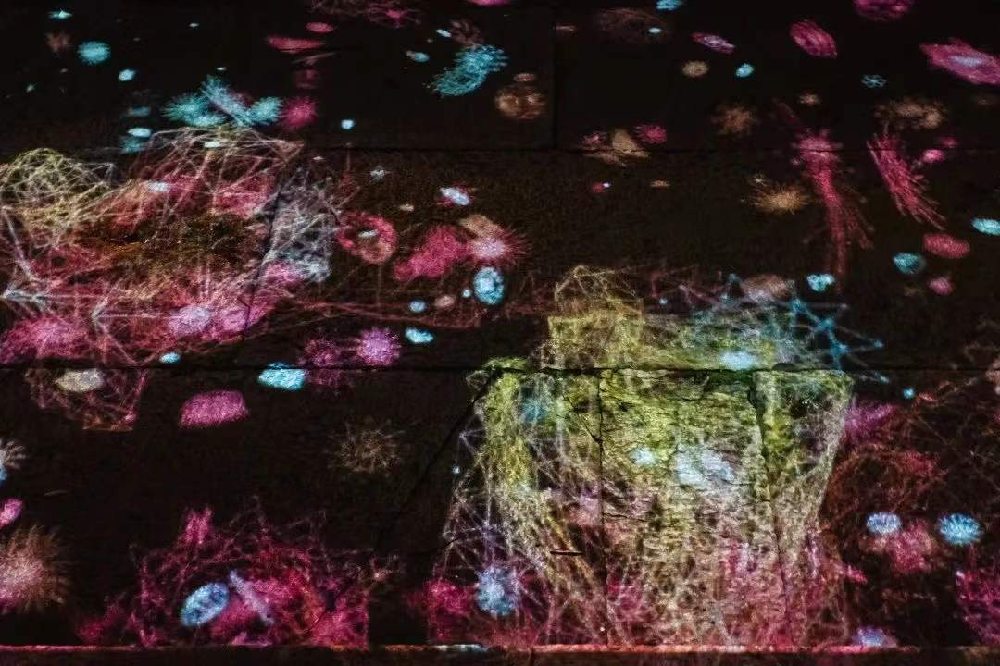
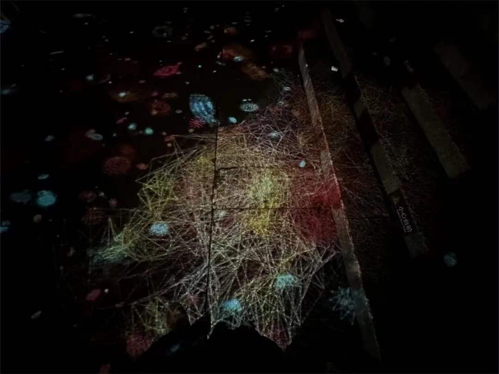

# 一眼万千 / One Glance, Ten Thousand

> 生成视觉与投影装置 · 2023 · 绍兴安昌

## 作品信息

| 项目 | 内容 |
| --- | --- |
| 作品 | **一眼万千** |
| 艺术家 | 钱誉文 / Ewan Qian |
| 创作记录日期 | **2023 年 1 月 28 日**（作者提供；不等同于展览开幕日期） |
| 类型 | 生成视觉、投影装置 |
| 呈现 | 安昌光影艺术季 2023《焕然·安昌》光影艺术展 |
| 地点 | 浙江绍兴安昌，安康桥附近 |
| 形式 | 将生成的花朵与流动图像投射到青石桥面、台阶和行走路径 |

## 作品简介

生成的花朵、线状网络与光点被投射到绍兴安昌的古桥及石阶，让经过桥面的人、时间与地方记忆共同进入影像。

像素是投影的技术基础，而不是作品的全部。当影像贴合一座已有多年日常通行历史的桥，花朵的生成和消散便与曾经、正在或可能经过这里的生命发生关联。那些通过照片或网络想象抵达此地的人，也成为作品所指向的另一层空间经验。

## 艺术家原始阐述（2023）

> 如果只是看到由投影仪投出的0~255控制的像素点组成的图像，当然是不完整的，就像现实世界和数字世界没有办法脱离彼此一样。
>
> 当桥面上的数字投影与现实世界的意义重叠，它就可以映射出百年间从这个桥上走过的生命。不只是过去的生命，也可能代表着，现在的还有未来的。不只是现实的，有可能在网络上通过照片还有想象中到达此地的人。它像是一条会流动的水，映射着我们在现实生活中看不到的人事物。

## 随作品提供的展览说明（原文）

> 自然界的生命生生不息，它总是在不断地生长和发展，繁花似锦，一眼万千。《一眼万千》以各色花朵为形象依托，通过视觉手段投放在青石板桥上，展现生命的力量和美丽，并让人们感受到在水、桥、花之间生命的不断流动、绽放与变幻。

## 现场影像

四张 2026 年由艺术家补充的现场 JPEG 以原始字节保存在此仓库和个人 `art-works` 档案；未裁剪、未重新编码。摄影者姓名和第三方再许可范围不作推断。

## 关联链接

- [正式个人网站作品页](https://ewanqian.site/works/glance-thousand-install-2023.html)
- [创作观念与原始照片独立存档](https://github.com/ewanqian/art-works/blob/main/works/one-glance-ten-thousand-2023.md)
- [旧版永久项目记录](https://ewanqian.site/works/projects/glance-thousand-install-2023.html)

本页作为作品事实和长篇文字来源；公开页面的版式与媒体展示由网站页面独立完成。
